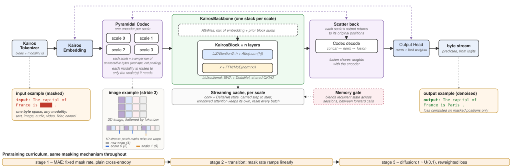

<h1 align="center">
<p>🌀 KairosFM</p>
</h1>

<p align="center">
<a href="https://pypi.org/project/kairos-fm/">

</a>
<a href="https://arxiv.org/abs/2610.12495">

</a>
<a href="https://github.com/fabienfrfr/kairos">

</a>
<a href="https://huggingface.co/ffurfaro">

</a>
</p>

<h3 align="center">
<p>Kairos Foundation Model — less parameters, more signal.</p>
</h3>

> **Status**: pre-1.0. The only result so far is a set of convergence sanity checks at 1--15M parameters
> (see the [paper](https://arxiv.org/abs/2610.12495)). Generalization, multimodal training and any
> comparison with existing models are **not yet measured**. Expect breaking changes until v1.0.0.

**Kairos** is an experimental byte-level, multimodal, hybrid MoE diffusion model designed to be trained on a
single local machine. It combines bidirectional gated **DeltaNet** and **sliding-window attention** over shared
projections (*LiZAttention2*), block-wise **Attention Residuals** (AttnRes), a sparse **MoE** feed-forward layer
and a multi-scale byte **PyramidalCodec**, trained with a uniform-noise denoising objective over one byte space
shared by text, image, audio, video, lidar and control streams.

The design target (200M total / 25M active parameters, 4 of 32 experts) is sized analytically in the paper; it
has not been instantiated or trained.

## What the paper shows

* The implementation optimizes: tiny networks drive the denoising loss of a fixed 440-byte sentence near zero.
* Codec ranking after 600 steps is stable over 3 seeds (patch codec 0.018 to depthwise conv codec 0.354).
* The advantage of shared over separate attention projections is a convergence-speed effect, not a capacity effect.
* The curriculum and the memory gate have no supporting result yet.

```bibtex
@misc{furfaro2026kairos,
  title         = {Kairos: Toward a Byte-Level Foundation Model for Every Modality},
  author        = {Furfaro, Fabien},
  year          = {2026},
  eprint        = {2610.12495},
  archivePrefix = {arXiv},
  url           = {https://arxiv.org/abs/2610.12495}
}
```

## Architecture



* **Tokenizer**: one 290-entry byte vocabulary for every modality (ByT5-based), plus modality and octet-family streams.
* **PyramidalCodec**: parallel views of the sequence at growing patch sizes, fused after upsampling.
* **Backbone block**: pre-norm LiZAttention2 (DeltaNet + window attention, shared Q/K/V/O) and a shared-expert MoE FFN.
* **AttnRes**: learned, block-windowed aggregation of earlier layer outputs.
* **Objective**: uniform-replacement denoising with a three-stage curriculum (MAE, transition, diffusion).
* **Memory gate**: seeds each DeltaNet state from states left by earlier sequences.

## Quick start

```bash
uv sync --group dev          # dev tools
uv sync --extra cli          # `kairos` command (train, overfit, evaluate, generate)
uv run kairos --help
make test                    # pytest
```

Example configs live in `configs/` (ablation configs in `configs/ablations/`).

**One-command pretraining** (model, data and Hub target all come from `configs/pretrain.yaml`):

```bash
echo "HF_TOKEN=hf_..." > .env
make pretrain NAME=d64-e7          # HF datasets -> train -> push to ffurfaro/kairos under d64-e7/
make pretrain ARGS="--no-push"      # train only
make pretrain ARGS="--set hf_data.text_pct=1"   # quick dev run
```

Fused DeltaNet / causal-conv1d kernels are optional (pure-PyTorch fallback otherwise):

* NVIDIA/CUDA: `uv sync --extra fast-attn`.
* AMD/ROCm: `uv sync --extra rocm` (PyTorch ROCm build only); add `--extra fast-attn-rocm` to compile the fused
  kernels (needs the ROCm HIP toolchain). `fast-attn` is mutually exclusive with the ROCm extras.

## Data & training

1. Build the multimodal pilot dataset (resumable, pushes to
   [`ffurfaro/keep-it-simple-multimodal`](https://huggingface.co/datasets/ffurfaro/keep-it-simple-multimodal)):
   `make build-multimodal`. Two sources are gated on the Hub
   ([finevideo](https://huggingface.co/datasets/HuggingFaceFV/finevideo),
   [Cosmos-Transfer-LidarGen](https://huggingface.co/datasets/nvidia/Cosmos-Transfer-LidarGen-Example)):
   accept their terms, then `huggingface-cli login` or export `HF_TOKEN`.
2. Train with the [marimo](https://marimo.io) notebook: `make notebook` (`notebook/kairos_pretraining.py`).
   It uses `ffurfaro/keep-it-simple` (text) and `ffurfaro/keep-it-simple-multimodal`, and logs to TensorBoard.
3. Push: `pipe.push_to_hub("ffurfaro/kairos")` (native HF format, checkpoints, TensorBoard run, model card).

**Next step** (from the paper): a pretraining run with held-out loss per stage and modality, and a bits-per-byte
comparison with Pythia-14M.

## Code structure

| Path | Role |
|---|---|
| `kairos/modeling.py` | `KairosConfig`, top-level model, DeltaNet/SWA blocks, MoE wiring, memory bank |
| `kairos/attentions.py` | LiZAttention2 and the sliding-window kernel |
| `kairos/tokenizer.py` | Shared byte-level multimodal tokenizer |
| `kairos/dataset.py` | Pretraining/SFT/RL dataset builders, multimodal packing |
| `kairos/pipeline.py` | Tokenizer, dataset, model, train and `push_to_hub` pipeline |
| `kairos/trainer.py` | Masked-diffusion loss and curriculum |
| `kairos/cli.py` | `kairos` command line |
| `docs/paper/` | LaTeX source of the preprint |
| `docs/experiments/` | Ablation logs and paper audits |

## References

* Furfaro, *Kairos: Toward a Byte-Level Foundation Model for Every Modality* ([arXiv:2610.12495](https://arxiv.org/abs/2610.12495))
* Kimi Team, *Attention Residuals* ([arXiv:2603.15031](https://arxiv.org/abs/2603.15031))
